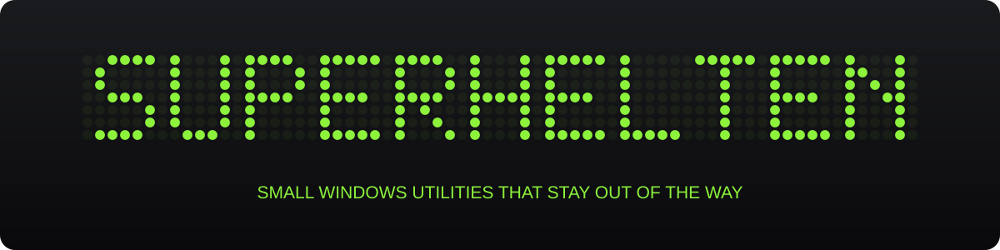
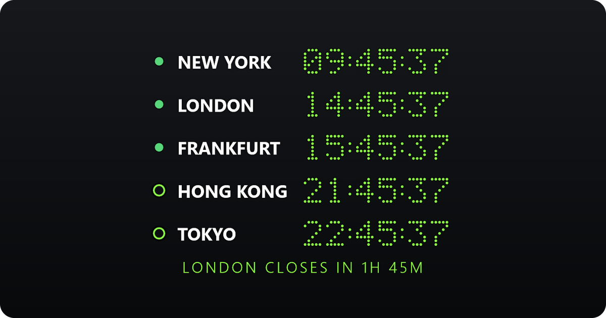
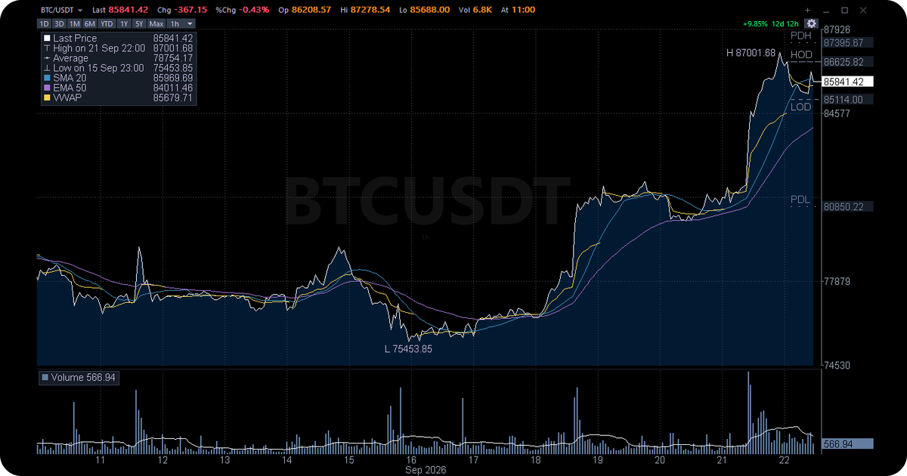
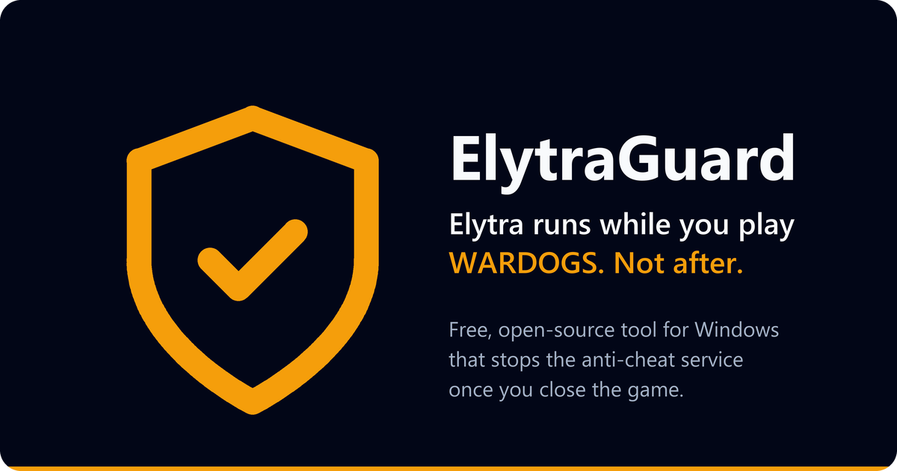
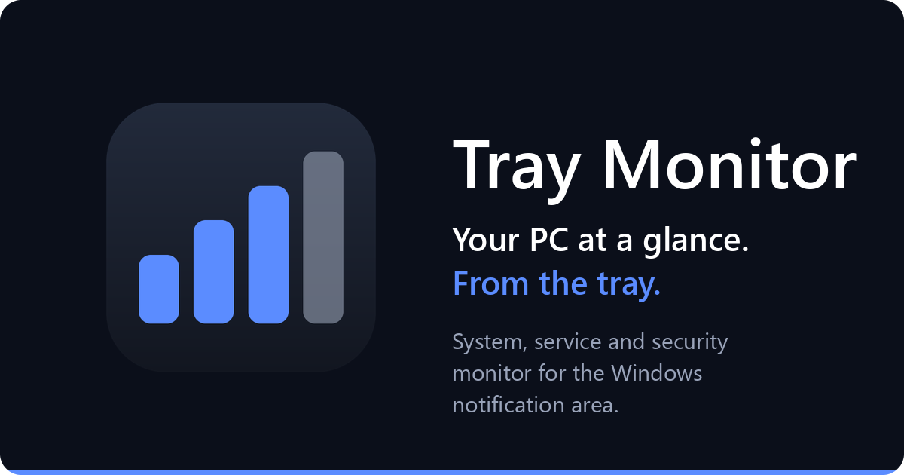

  

Small Windows utilities that do one job and stay out of the way.
Each one is a single download, with no account to create.

<table>
  <tr>
    <td width="50%" valign="top">
      
      <h3>ChronoDesk</h3>
      Transparent always-on-top desktop clock with a stopwatch, a timer and a board showing which stock exchanges are open.
        
      Rust · egui
       
      <a href="https://github.com/superhelten/chronodesk/releases/latest"><b>Download</b></a> ·
      <a href="https://superhelten.github.io/chronodesk/">Website</a> ·
      <a href="https://github.com/superhelten/chronodesk">Source</a>
    </td>
    <td width="50%" valign="top">
      
      <h3>TickC</h3>
      Crypto price ticker for the tray, with a chart panel, price alerts and a desktop-wallpaper mode.
        
      C · Win32
       
      <a href="https://github.com/superhelten/TickC/releases/latest"><b>Download</b></a> ·
      <a href="https://github.com/superhelten/TickC">Source</a>
    </td>
  </tr>
  <tr>
    <td width="50%" valign="top">
      
      <h3>ElytraGuard</h3>
      Stops the Elytra anti-cheat service once WARDOGS has closed, so it only runs while you play.
        
      PowerShell
       
      <a href="https://github.com/superhelten/elytraguard/releases/latest"><b>Download</b></a> ·
      <a href="https://superhelten.github.io/elytraguard/">Website</a> ·
      <a href="https://github.com/superhelten/elytraguard">Source</a>
    </td>
    <td width="50%" valign="top">
      
      <h3>Tray Monitor</h3>
      System, service and security monitor in the notification area. Closed source; installers only.
        
      Electron · Rust
       
      <a href="https://github.com/superhelten/tray-monitor-releases/releases/latest"><b>Download</b></a>
    </td>
  </tr>
</table>

All of them run on Windows 10 and 11.

## Good to know

- The installers are not code-signed yet, so SmartScreen may warn on first run. ChronoDesk and ElytraGuard publish a `SHA256SUMS.txt` with each release so you can check the file first.
- Found a bug or missing something? Open an issue in the project's repository.
